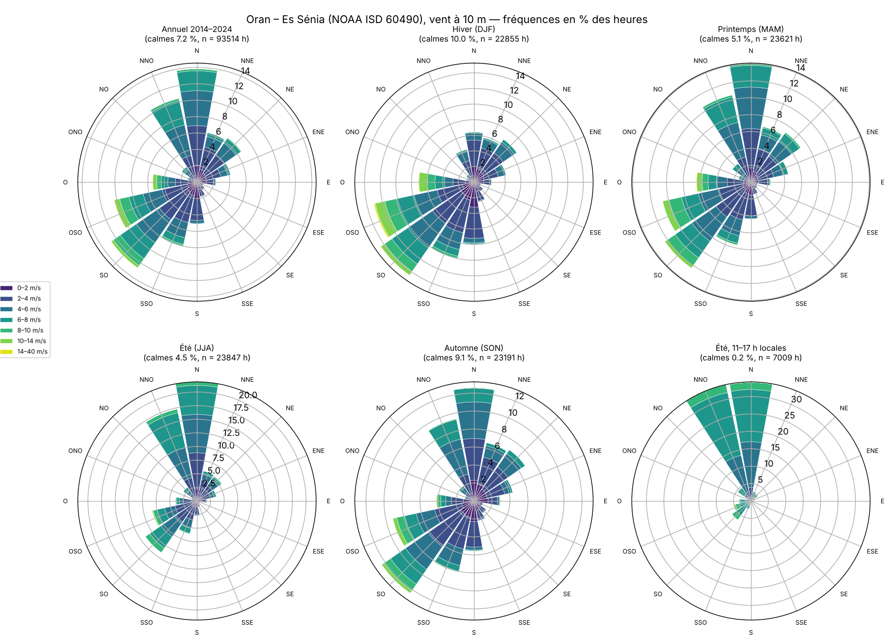
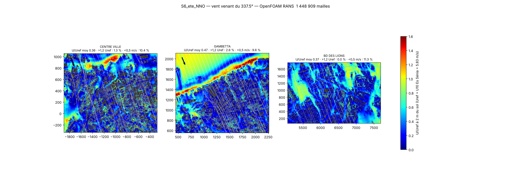
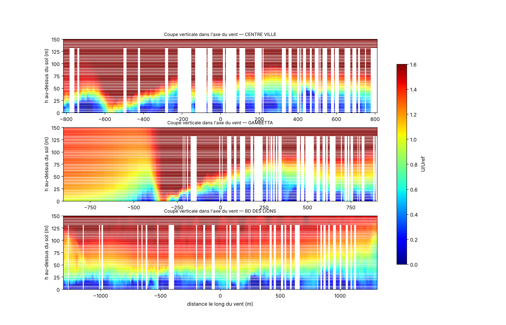
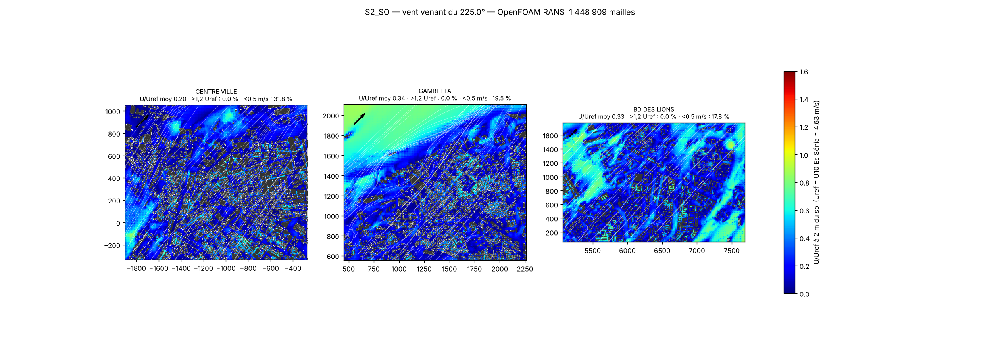
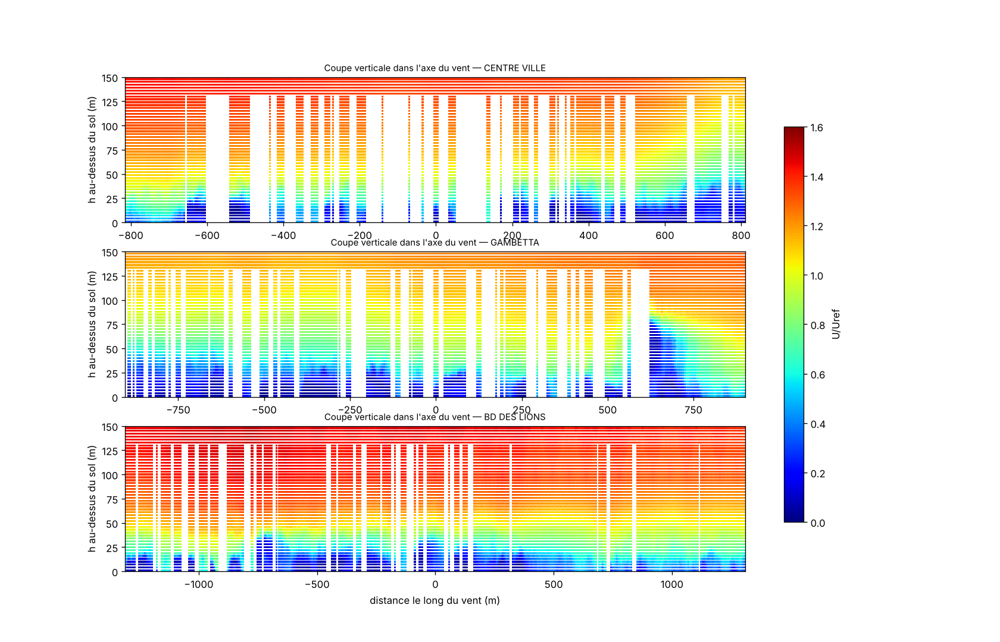
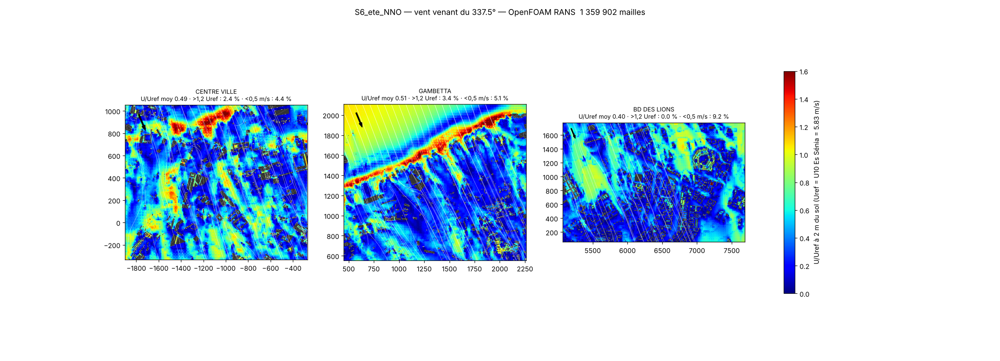
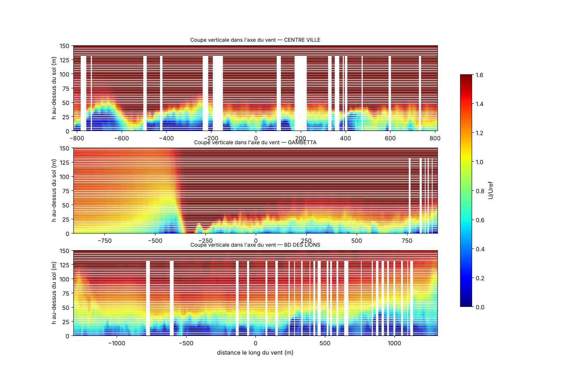

# Vent et chaleur dans trois secteurs d'Oran — étude CFD sur la maquette Rhino 8

*Rapport scientifique — centre-ville, Gambetta, boulevard des Lions. Toutes les valeurs proviennent des fichiers de résultats du dépôt ; les étapes non réalisées sont signalées comme telles.*

## 1. Objectif et périmètre

Étudier, à partir des maquettes numériques existantes (maquette urbaine détaillée et maquette thermique), l'écoulement du vent à hauteur de piéton, les accélérations, canalisations, zones abritées et recirculations, puis l'effet des températures de surface sur la température de l'air, dans trois secteurs d'Oran. Les calculs ont été réalisés avec **OpenFOAM v1912** (ANSYS n'était pas disponible dans l'environnement de calcul) ; un paquet **ANSYS Fluent** avec le même maillage et les mêmes conditions aux limites est fourni pour refaire les cas sous Fluent.

## 2. Données d'entrée

### 2.1 Maquettes Rhino 8 (inspection des fichiers)

| Fichier | Objets | Calques | Matériaux | Unité | Remarques |
|---|---|---|---|---|---|
| `Oran_Thermal_2024_3D.3dm` (394,5 Mo) | 3084 | 407 | 23 | Meters | 223 maillages ouverts (surfaces drapées), 0 invalides, 0 doublons |
| `Oran_maquette_urbaine_detaillee_Rhino8.3dm` (812,5 Mo) | 110416 | 334 | 24 | Meters | 207 maillages ouverts (surfaces drapées), 0 invalides, 0 doublons |

Les deux fichiers sont dans le même repère (Transverse Mercator local centré sur 35,699 N / 0,635 O, mètres) ; les points d'ancrage terrestres diffèrent de moins de 0,4 m. La carte thermique (LST du 10/07/2024) a été calée sur la maquette blanche ; le lien maquette → Terre de la maquette détaillée ayant été corrigé depuis, la correction connue d(x,y) ≈ (+3,6 ; −32,7) m est appliquée lors du couplage thermique.

### 2.2 Vent observé (Oran – Es Sénia)

Source : NOAA ISD 60490099999 ES SENIA (35.624N 0.621W, 90 m), période 2014-01-01 → 2024-12-31, **93514 heures** valides après contrôle qualité (codes ISD), une valeur par heure (METAR prioritaire). Hauteur 10 m, exposition aéroportuaire.

* Vitesse moyenne 3,63 m/s, médiane 3,1, P90 7,2, P99 10,8, max 20,1 m/s ; calmes 7,2 %.
* Loi de Weibull : k = 1,74, c = 4,41 m/s.
* Hiver (DJF) : 3,35 m/s, directions dominantes SO (14,5 %), OSO (13,1 %), SSO (10,0 %), air 12,2 °C.
* Printemps (MAM) : 3,98 m/s, directions dominantes N (14,1 %), SO (12,4 %), OSO (10,7 %), air 17,3 °C.
* Été (JJA) : 3,96 m/s, directions dominantes N (21,9 %), NNO (17,3 %), SO (11,6 %), air 25,7 °C.
* Automne (SON) : 3,22 m/s, directions dominantes N (12,6 %), SO (12,5 %), NNO (9,4 %), air 20,1 °C.
* Après-midi d'été (11–17 h) : 5,83 m/s, NNO (34,2 %), N (34,1 %), SO (6,7 %).

Deux régimes : **brise de mer N/NNO** (jour, été) et **vent de terre SO/OSO** (nuit, hiver). Scénarios retenus :

| Scénario | Direction (d'où vient le vent) | U10 de référence | Fréquence | Rôle |
|---|---|---|---|---|
| S1_N | 0,0° | 3,93 m/s | 13,8 % | direction dominante observée, vitesse moyenne du secteur |
| S2_SO | 225,0° | 4,63 m/s | 12,7 % | direction dominante observée, vitesse moyenne du secteur |
| S3_NNO | 337,5° | 4,75 m/s | 10,5 % | direction dominante observée, vitesse moyenne du secteur |
| S4_OSO | 247,5° | 5,02 m/s | 10,4 % | direction dominante observée, vitesse moyenne du secteur |
| S5_N_fort | 0,0° | 6,70 m/s | 13,8 % | même direction, vent fort (P90 du secteur) : confort/sécurité |
| S6_ete_NNO | 337,5° | 5,83 m/s | 0,0 % | après-midi d'été (situation des cartes LST) : cas couplé thermique |

### 2.3 Secteurs d'étude (localisés sur des données nommées Overture/OSM)

* **CENTRE VILLE** — Place du 1er Novembre / Sidi El Houari / bd Larbi Ben M'hidi (Overture divisions + places) — boîte modèle [-1901, -333, -271, 1054] m (1.63 × 1.39 km).
* **GAMBETTA** — Cité Gambetta (Overture division 'Gambetta', centroïde -0.61982 / 35.71145) — boîte modèle [452, 555, 2262, 2108] m (1.81 × 1.55 km).
* **BD DES LIONS** — Boulevard des Lions (Overture segments, -0.5757 -> -0.5522) + rond-point — boîte modèle [5068, 57, 7691, 1779] m (2.62 × 1.72 km).

## 3. Géométrie de calcul (dérivée, maquette originale intacte)

Bâti de référence : calque principal de la maquette (`BUILDINGS::*`), découpé en bâtiments individuels par composantes connexes, secteur + 300 m. Relief : grille Copernicus de la maquette (697 × 417 nœuds, 25 m).

| Secteur | Bâtiments (dont cœur) | Hauteur médiane | P95 | Max | LST 2024 sous toiture |
|---|---|---|---|---|---|
| CENTRE VILLE | 6959 (4186) | 15,5 m | 22,3 m | 60,7 m | 6837 |
| GAMBETTA | 7100 (4277) | 15,3 m | 21,8 m | 116,9 m | 7013 |
| BD DES LIONS | 5438 (3248) | 16,3 m | 29,5 m | 37,8 m | 5398 |

Variante de sensibilité : emprises réelles OSM/Google/Microsoft — couverture bâtie 11 / 7 / 14 % contre 43 / 25 / 25 % pour le bâti de référence : jeu **incomplet** à Oran, utilisé seulement pour mesurer l'effet de la densité.

Chaque bâtiment porte un identifiant (`batiments_cfd.csv` : cfd_id ↔ calque et identifiant d'objet Rhino) ; le script Rhino R02 reproduit cette préparation dans une copie `_CFD_WORK` du fichier.

## 4. Modèle numérique

* **mesh_ref_coarse** : 1448909 mailles, non-orthogonalité max 79.25424° (moyenne 18.05435°), dissymétrie max 19.84696, volume min 8.955399. m³ (aucun volume négatif).
* Domaine 17 × 10 km × 900 m couvrant les 3 secteurs ; snappyHexMesh, mailles de fond 100 m (grossier) / 80 m (fin), raffinement de boîte autour des secteurs, mailles de 12,5 m (grossier) / 6,25 m (fin) contre les bâtiments.
* Entrée : couche limite neutre (Richards & Hoxey) — U(z) = u*/κ ln((z−zg+z0)/z0), k = u*²/√Cμ, ε = u*³/(κ(z−zg+z0)) ; u* déduit du U10 observé à Es Sénia (z0 = 0,03 m) puis transposé à la rugosité amont via une hauteur de mélange de 60 m.
* Sol : `nutkAtmRoughWallFunction`, z0 par face (mer 0,0002 m ; secteurs à bâti explicite 0,05 m ; tissu urbain 0,5 m ; autre 0,1 m). Bâtiments : lois de paroi lisses. Sorties : pression nulle ; faces parallèles et sommet : glissement.
* Turbulence : RANS **k-ε réalisable** (bon compromis pour les écoulements décollés autour des bâtiments, COST 732 / AIJ) ; SIMPLE, quantité de mouvement linearUpwind limité, k et ε upwind.
* Thermique : `buoyantBoussinesqSimpleFoam` (Boussinesq, β = 3,3·10⁻³ K⁻¹), toitures et sol à la **LST du 10/07/2024** (température de surface imposée), murs à la température de l'air (aucune donnée), air entrant à la moyenne observée des après-midi d'été.

## 5. Résultats

### S6 été NNO — maillage grossier (référence)

OpenFOAM v1912 simpleFoam, RANS realizable k-epsilon — 1448909 mailles — 1200 itérations — déséquilibre de masse 0,0002 % — résidus finaux Ux 7.5e-04, Uy 3.8e-04, Uz 1.3e-03, p 1.2e-02, epsilon 2.2e-04, k 1.7e-03.

| Secteur | U moy 2 m | U P90 | U/Uref | > 1,2 Uref | < 0,5 m/s | flux inversé |
|---|---|---|---|---|---|---|
| CENTRE VILLE | 2,07 m/s | 4,17 | 0,36 | 1,3 % | 10,4 % | 29,5 % |
| GAMBETTA | 2,76 m/s | 5,72 | 0,47 | 2,6 % | 9,6 % | 24,2 % |
| BD DES LIONS | 2,16 m/s | 4,40 | 0,37 | 0,0 % | 11,3 % | 19,5 % |

### S2 SO — maillage grossier

OpenFOAM v1912 simpleFoam, RANS realizable k-epsilon — 1448909 mailles — 1200 itérations — déséquilibre de masse 0,0000 % — résidus finaux Ux 1.7e-08, Uy 1.9e-08, Uz 2.7e-07, p 1.0e-03, epsilon 1.0e-08, k 1.0e-07.

| Secteur | U moy 2 m | U P90 | U/Uref | > 1,2 Uref | < 0,5 m/s | flux inversé |
|---|---|---|---|---|---|---|
| CENTRE VILLE | 0,95 m/s | 1,93 | 0,20 | 0,0 % | 31,8 % | 29,1 % |
| GAMBETTA | 1,56 m/s | 3,35 | 0,34 | 0,0 % | 19,5 % | 16,5 % |
| BD DES LIONS | 1,52 m/s | 2,93 | 0,33 | 0,0 % | 17,8 % | 19,5 % |

Stabilité itérative du champ piéton : 0,003 % entre 1000 et 1200; 0,013 % entre 1000 et 1200; 0,001 % entre 1000 et 1200.

### S6 thermique couplé (Boussinesq)

*Calcul non disponible au moment de la génération du rapport.*

### S6 été NNO — maillage fin

*Calcul non disponible au moment de la génération du rapport.*

### S6 — variante bâti « emprises réelles » (sensibilité)

OpenFOAM v1912 simpleFoam, RANS realizable k-epsilon — 1359902 mailles — 1000 itérations — déséquilibre de masse 0,0014 % — résidus finaux Ux 8.2e-04, Uy 4.2e-04, Uz 1.5e-03, p 1.6e-02, epsilon nan, k nan.

| Secteur | U moy 2 m | U P90 | U/Uref | > 1,2 Uref | < 0,5 m/s | flux inversé |
|---|---|---|---|---|---|---|
| CENTRE VILLE | 2,84 m/s | 5,21 | 0,49 | 2,4 % | 4,4 % | 15,1 % |
| GAMBETTA | 2,98 m/s | 5,82 | 0,51 | 3,4 % | 5,1 % | 12,4 % |
| BD DES LIONS | 2,36 m/s | 4,53 | 0,40 | 0,0 % | 9,2 % | 17,7 % |

## 6. Validation et incertitudes

*Comparaison de maillages : le calcul fin n'était pas disponible à la génération du rapport.*

Sensibilité à la densité du bâti (S6, même maillage grossier) : U/Uref moyen CENTRE VILLE 0,49 (emprises incomplètes) → 0,36 (référence); GAMBETTA 0,51 (emprises incomplètes) → 0,47 (référence); BD DES LIONS 0,40 (emprises incomplètes) → 0,37 (référence).

* **Validé numériquement** : bilans de masse (< 10⁻⁵), stabilité des champs piétons entre itérations, qualité du maillage (aucun volume négatif).
* **Estimé** : valeurs à 2 m sur maillage grossier (mailles de 12,5 m près des bâtiments : les rues étroites sont mal résolues) ; RANS stationnaire (les sillages instationnaires sont moyennés) ; hauteurs du bâti en multiples de 3 m ; formes du bâti de référence générées.
* **Non validé faute de mesures** : aucune mesure de vent intra-urbaine n'est disponible ; la station d'Es Sénia (hors domaine, ~9 km au sud) ne sert qu'à fixer l'entrée. Des mesures anémométriques ponctuelles dans les rues seraient nécessaires.
* **Thermique** : les températures imposées sont des températures de **surface** reconstruites depuis une figure (LST), pas des mesures de l'air ; les murs n'ont pas de donnée ; le rayonnement n'est pas modélisé.

## 7. Workflow Rhino 8 ↔ ANSYS (livrables)

* `rhino_ansys/rhino/R01_diagnostic_scene.py` — inventaire de la session Rhino (arrière-plan, lecture seule).
* `rhino_ansys/rhino/R02_preparation_geometrie_cfd.py` — géométrie de calcul dans une copie `_CFD_WORK`, identifiants traçables, export STL.
* `rhino_ansys/rhino/R03_import_resultats.py` — réimport des CSV (nuage de vitesses, flèches, lignes de courant, accélérations, recirculations).
* `rhino_ansys/ansys/A02_pyfluent_solve.py`, `A03_lancer_file_attente.py` — même cas sous Fluent, file d'attente en processus séparé.
* `scripts/cfd/40…50` — chaîne complète reproductible (climat de vent, inventaire, géométrie, maillage, calcul, post-traitement, vues, rapport).

## 8. Références

* NOAA NCEI, Integrated Surface Database (ISD), station 60490099999 Es Sénia — miroir public s3://noaa-global-hourly-pds.
* Overture Maps Foundation, release 2026-09-23.1 (divisions, places, transportation) — localisation des secteurs.
* Copernicus DEM GLO-30 (ESA) — relief de la maquette.
* Richards P.J., Hoxey R.P. (1993), Appropriate boundary conditions for computational wind engineering models using the k-ε model, JWEIA 46-47.
* Franke J. et al. (2007), Best practice guideline for the CFD simulation of flows in the urban environment, COST Action 732.
* Tominaga Y. et al. (2008), AIJ guidelines for practical applications of CFD to pedestrian wind environment around buildings, JWEIA 96.
* Blocken B. et al. (2007), CFD simulation of the atmospheric boundary layer: wall function problems, Atmospheric Environment 41.
* Shih T.-H. et al. (1995), A new k-ε eddy viscosity model for high Reynolds number turbulent flows (k-ε réalisable), Computers & Fluids 24.
* Figure LST 1984–2024 : « Spatiotemporal Impact of Urbanization on Urban Heat Island Using Landsat Imagery in Oran, Algeria: 1984–2024 ».
